# Trading SIG's midterm Predictions Cup against real-money prices

By **[Arturo Favara](https://www.linkedin.com/in/arturo-favara/)** · bright-dawn-8174 on the leaderboard

<picture>
  <source media="(prefers-color-scheme: dark)" srcset="figures/equity_curve-dark.png">
  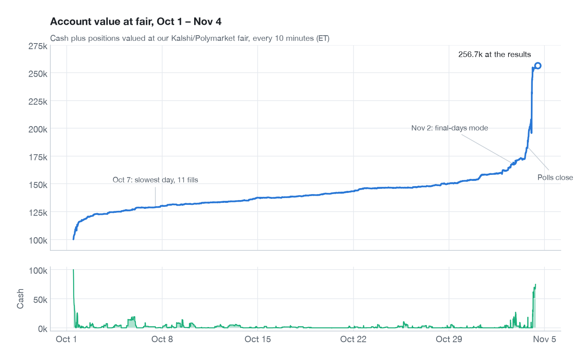
</picture>

From October 1 to November 4 2026, Susquehanna (SIG) ran the Predictions Cup on its play-money exchange, The Super Market: 237 contracts on the US midterms ("Will the Republican Party win the Rhode Island Senate?"), 100,000 SUSQies for everyone, ranked on the balance once every market has settled, with prizes for the top three.

I entered with a bot that priced every SIG market from Kalshi and Polymarket and traded against anyone on SIG who disagreed. It ran for 35 days and recorded everything it saw.

| | |
|---|---|
| Result | 100,000 → about **256,700** SUSQies (2.6x) |
| Rank | **#25 of 1,969** on November 9, with 213 of 237 markets settled |
| Trading | 11,137 fills in 191 markets |
| The bot | about 5,200 lines of Python in one asyncio process, 77 tests |
| Recorded | Kalshi, Polymarket and SIG prices for all 237 markets, every few seconds, Oct 1 – Nov 4 |

A good result, and nowhere near the top: the winner made about nine times as much. Below is how the bot worked, what the first day looked like across the whole market, where our money came from, one race up close, and election night. Then I use the recordings, together with the results, to answer questions about the market itself: who forecast the midterms best, how biased SIG's crowd was, how fast each venue moved on election night, and whether our trades kept their edge. The last part is about the accounts that beat us, and what I'd change.

**Contents:** [The idea](#the-idea) · [What the rules didn't say](#what-the-rules-didnt-say) · [How the bot works](#how-the-bot-works) · [Day one](#day-one-57-million-off-fair-in-eight-hours) · [The month](#a-month-of-fighting-for-cash) · [CO-03](#one-race-up-close-co-03) · [Election night](#election-night-and-the-last-morning) · [What the recordings show](#what-35-days-of-recordings-show) · [The rivals](#how-others-made-ten-times-more) · [Lessons](#what-id-do-differently)

## The idea

Every SIG market also traded for real money on Kalshi and Polymarket. SIG's players traded play money and mostly didn't look there. That gap was the strategy: turn the real-money prices into a fair value for each SIG market, and trade with anyone on SIG who was on the wrong side of it by more than the noise.

I didn't try to forecast the elections myself. Real-money markets pool polls, models and news faster than anything I could build in an evening, and as [the recordings show](#who-forecast-best), they were more accurate than SIG's crowd on every single day of the competition.

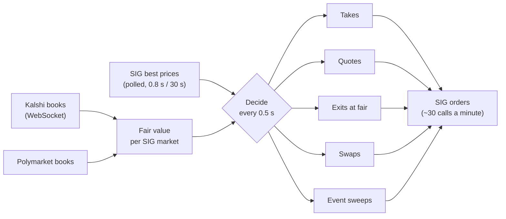

The constraint that shaped everything was cash. There's no borrowing: buying YES at 0.30 ties up 0.30 a share until the race settles or someone buys it back. A 5% edge held for a month is worth less than a 2% edge that comes back tomorrow, and most of the design below is about the price of cash.

The first version went from reading the rules to running in one evening. On September 30 the bot matched all 237 SIG markets to Kalshi and Polymarket by 9 pm, ran in shadow mode by 9:30, and was on a 2 GB AWS Lightsail server in Oregon, 5 ms from SIG's servers, by 10:35. A recorder went live on October 1 at 11:39 am, because SIG keeps no order-book history, and live trading was armed at 11:51 for the noon open.

## What the rules didn't say

Half of what mattered wasn't in the documentation. It showed up under live load and had to be measured.

| Finding | Why it mattered |
|---|---|
| Rate limits are per account, not per API key: about 100 price reads and 30 trade calls a minute in total. | A second server or more keys add nothing. I built a relay server on the per-IP theory before a test from my laptop proved it wrong. |
| SIG's realtime feeds were paused platform-wide from October 2. | Everyone polled. The bot polled the 100 busiest markets every 0.8 s, the rest every 30 s, and its own fills every 10 s. |
| An order with no buying power comes back as HTTP 200 with no order id. | It looks like success. The bot treats it as "no funds" and backs off that side for a minute. |
| `fillPrice` is reported on the side SIG actually traded. | Selling YES you don't hold is buying NO, so a YES sale at 0.265 comes back as 0.735. An early alert reported +3,408 on a trade that made +260. |
| There's no immediate-or-cancel flag, but a limit order that expires in 1–3 s is accepted. | Every take and funding sale uses one, so nothing is left resting below fair. |
| A race's Democrat and Republican markets are separate books. | Their prices drift apart. On election night CO-03's two best bids summed to 0.855. |
| Kalshi's tickers have traps: SENATELA-26 is Kentucky, two 2026 governor races end in -27 and -28, and some "Independent" markets pay only on a named candidate. | One wrong mapping would have priced a whole race wrongly at full size. |
| The leaderboard values open positions at SIG's own recent trade prices. | It understated us all month, by 32.5k at the close. Only cash after settlement counts. |

## How the bot works

Every half second the bot rebuilt a fair value for every market, compared it with SIG's best prices, and decided what to take, quote, exit or fund.

**Fair value.** On each venue, the midpoint of the average price to buy 200 contracts and to sell 200, so a 2-contract order at the top of a thin book can't move it. The two venues are blended in log-odds, with Kalshi's weight between 0.5 and 0.85 depending on how deep each book is, because Kalshi led short-run moves in 2026: Polymarket followed Kalshi about twice as often as the reverse. A venue is ignored if its spread is over 15 points or its data is more than 30 s old, and all orders are pulled if the external data goes stale for a minute.

**Six ways to trade:**

| | What it does |
|---|---|
| Takes | Hit a SIG order priced clearly through fair. One limit order at the worst acceptable price sweeps every level through it. Size grows with edge. |
| Quotes | Two-sided orders, only in markets where inventory reliably comes back: 1,000 shares where at least 80% of past positions closed within 24 hours, none below 40%. |
| Exits at fair | Every position offers all of itself at fair. Exits need no cash. |
| Swaps | When a take returning 5–8%+ is short of cash, sell other positions whose cost per unit of cash freed is at most min(return − 3 points, return ÷ 2), then take. |
| Event sweeps | Kalshi moves 3+ points in 5 minutes and Polymarket follows within a minute (or Kalshi's deep book holds): sweep SIG's stale side before it reprices. |
| Parking | Added on the last morning: in races Kalshi had already finalized, buy the winner wherever SIG still sold it below 0.985. |

**The price of cash.** Every trade has to pay for the days it ties up cash, at 0.2–0.5% a day depending on how much is free. A take must return at least that rate times the days it's expected to be held, and the days come from how far SIG usually trades from fair in that market: a tenth of a day where SIG tracks fair within a point, about four days at 2–4 points, and until settlement beyond that, because there exits at fair filled only 1.3% of the time.

**Who made the gap?** From October 11 every market carried a regime. When SIG and fair split by 2+ points, the bot looked at who had moved since they last agreed. Gaps made by Kalshi moving closed (SIG covered 57% of them within a day), so takes there were 1.5x bigger. Gaps made by SIG moving were reversion bets at half size. Gaps older than an hour almost never closed at fair (4% within a day), so they needed a 4-point edge, and inventory there was capped.

**Risk.** A worst-case loss cap per race that counts resting orders as filled, a cap on the net bet that Democrats overperform, exits only once a side is 90% likely (97% in the final days), a circuit breaker that cancels everything when fair jumps 4+ points in many markets at once, and a 10% drawdown stop. If the process died, systemd ran a cancel-all. If the server died, every order expired by itself within 2 hours. Every deploy ran the test suite first, and I approved every change that touched money or risk.

## Day one: 5.7 million off fair in eight hours

<picture>
  <source media="(prefers-color-scheme: dark)" srcset="figures/day1_tape-dark.png">
  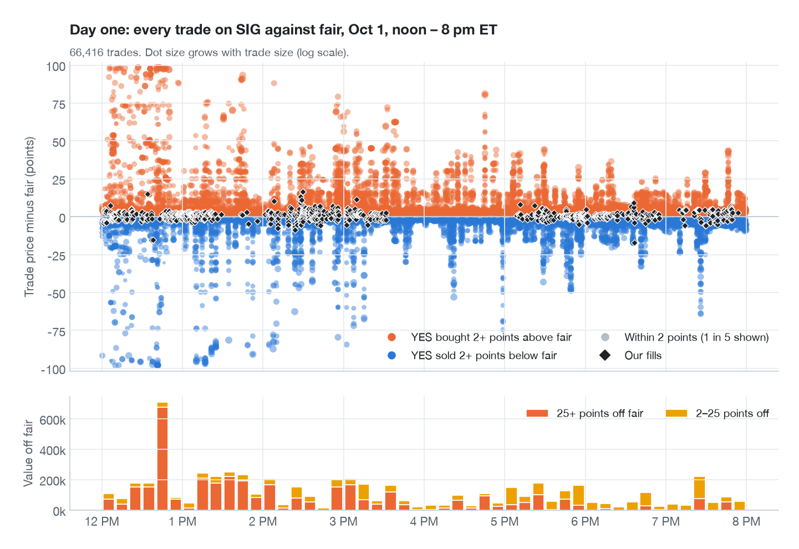
</picture>

At 11:59 am every book held only SIG's own market maker, about 4 points wide around a Kalshi-like price. Within three minutes of the open, many had been swept to the price limits.

Between noon and 8 pm SIG printed 66,416 trades. 29,650 of them were at least 2 points from fair, worth **5.71 million** SUSQies of mispricing (distance from fair times shares) in 225 markets, 1.33 million of it in the first hour. The money was far from fair: 3.64 million traded 25+ points away and 2.41 million 50+ points away. Only 0.79 million sat in the 2–10 point band where a normal quoting bot lives.

What it looked like:

- **Orders for a size, not a price.** Market orders went through empty books: someone bought 99,649 Rhode Island Senate R at 0.99 when fair said 1%, South Carolina Senate R traded at 0.005, North Carolina Senate D at 0.995. Kansas Senate D swept our whole quote ladder three times in 20 minutes.
- **Longshot bias.** SIG's players overpaid for longshots and underpaid for favorites, in both parties: Rhode Island Senate R at 8.5% against 1.2% fair, CA-22 R at 13.5% against 7%. It lasted [all month](#sigs-longshot-bias).
- **Stale quotes.** SIG prices left behind after Kalshi moved. Other accounts took most of them within seconds.

The bot caught 9,377 of it, **0.16%**. Look at the black diamonds: they sit on the zero line, while the money was at the edges of the chart. Takes were capped at 2,000 shares, race caps were filling up with low-value positions, a classification bug left the bot mostly idle for 84 minutes, and others were faster: in the first 22 hours other accounts traded 95% of the free mispricings first, a median 4.4 seconds before our poll even saw them. The good news was that there was no adverse selection: across 686 quote fills, fair didn't move against us after 1, 5 or 30 minutes.

## A month of fighting for cash

After day one the problem was never finding mispricings. It was having the cash to act on them. Between October 2 and November 1, cash was under 3,000 in 83% of the bot's 10-minute snapshots, with a median of 138 (the green strip under the equity curve at the top).

- **Oct 2–6, taming the machine.** Near-certain markets became exits only, exits moved to fair, polling was re-spent under the per-account cap, the price of cash arrived, and quotes were limited to markets whose inventory comes back.
- **Oct 7–11, the cash problem.** October 7 was the slowest day: 11 fills, with free cash under 2,000. I let exits pay to free cash. Measured over three days it was a wash: paying 4–7% to free cash for takes earning 6%. Swaps were restricted to takes returning 8%+, with a guard against re-opening what we'd just sold.
- **Oct 12 – Nov 1, steady state.** New edge came from takes funded by swaps, event sweeps after real moves, and the longshot-bias inventory slowly marking up as Election Day approached.
- **Nov 2–4, the final days.** A 100,000 war chest for election night, sizes doubled, then election night and parking.

<picture>
  <source media="(prefers-color-scheme: dark)" srcset="figures/purpose-dark.png">
  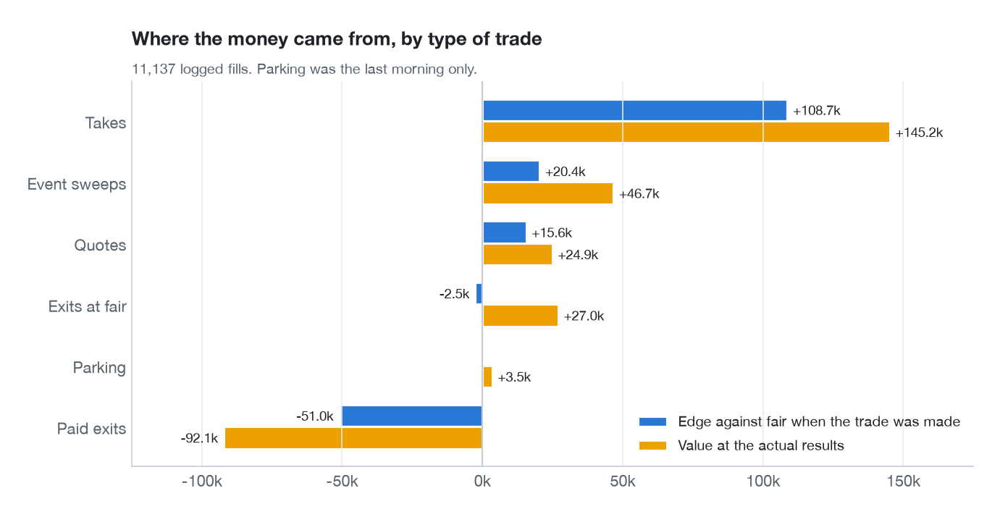
</picture>

Takes made the money, both against fair when we traded and against the results. Paying to free cash cost more than it looked: −51k against fair when we sold, −92k against the outcomes, because what we sold to fund other trades was mostly favorites, and favorites mostly won.

The clearest lesson of October was Montana's 1st district on October 5. At 7:05 pm Kalshi moved R from 64.5% to 67.5%, Polymarket confirmed, and SIG sat still for about 19 minutes while fair walked to 0.76. Other accounts took 143,559 stale shares worth about 9.8k of edge within five minutes. The bot took 7,515 shares worth 632: its normal takes were held back by the carry bar, by a "Kalshi is thin" check and by the race cap, and the event trigger never fired on the second leg because the first was still open. On October 9 event rules were changed to stay on for 30 minutes per race, re-arm on a further move, and move a market to the fast poll on Kalshi's first point.

<picture>
  <source media="(prefers-color-scheme: dark)" srcset="figures/daily-dark.png">
  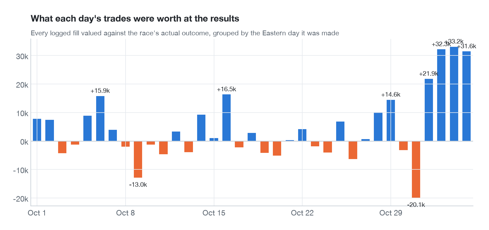
</picture>

Almost two-thirds of the result, 97k of 155k, came from trades made in the last three days.

## One race up close: CO-03

<picture>
  <source media="(prefers-color-scheme: dark)" srcset="figures/markets-dark.png">
  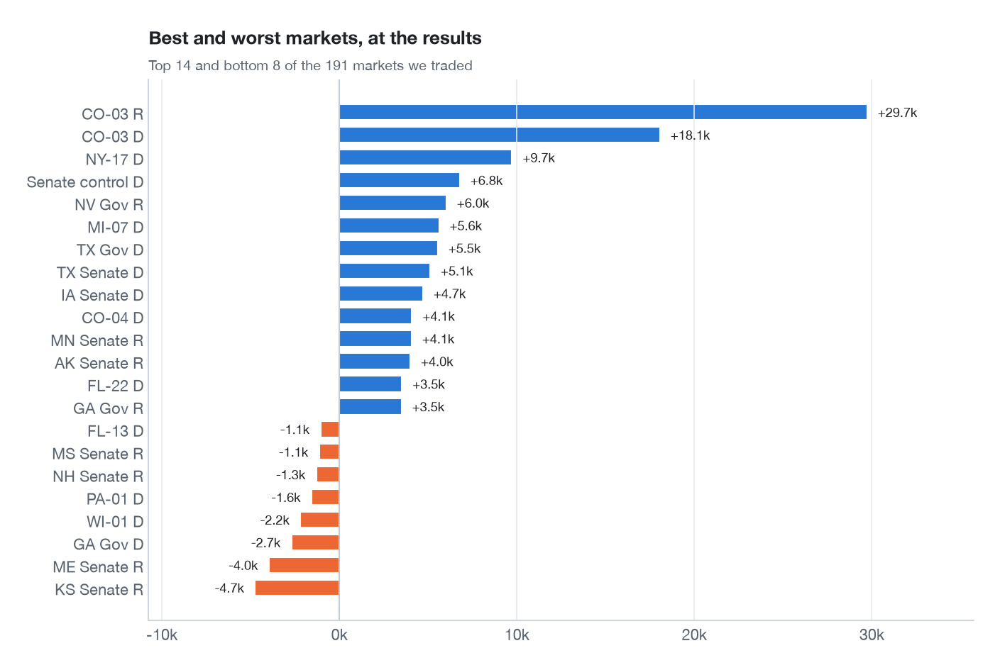
</picture>

<picture>
  <source media="(prefers-color-scheme: dark)" srcset="figures/co03-dark.png">
  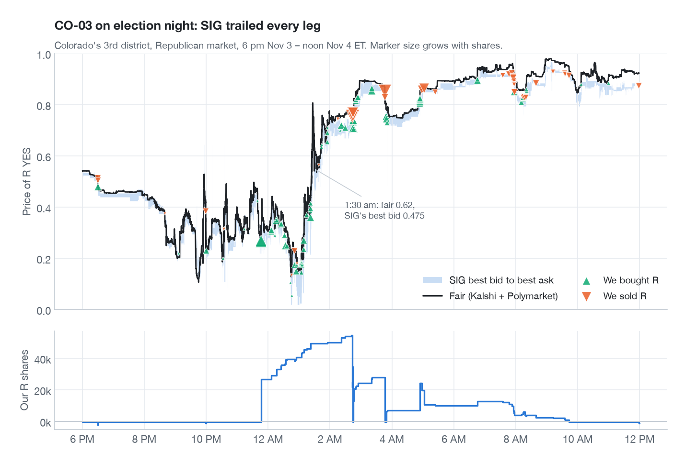
</picture>

Colorado's 3rd district paid more than any other race: +29.7k in the Republican market and +18.1k in the Democrat one. All October SIG priced the Democrat too high in a race Kalshi gave the Republican about 70%, so the bot sold D repeatedly. By Election Day it was a coin flip, and SIG tracked fair within a point. Then the count started. Fair for R fell to 0.12, came back to 0.98 and closed near 0.94, and SIG trailed every leg.

- **Two books, one race.** At 1:30 am CO-03's two best bids summed to 0.855 and its asks to 1.035. At 8:45 pm the two asks summed to 0.985, so buying both YES sides locked 1.5% for nothing.
- **SIG lagged by up to 15 points.** At 1:30 am fair was 0.62 and SIG's best bid 0.475. SIG was still 6 points under fair at the noon close.
- **Exits turned the position over.** Around 2 am the bot bought 52,790 R at 0.742 against fair 0.789 and sold 78,581, mostly through resting exits at fair.
- **The last trade was a paid exit.** At 11:58 am a swap sold 1,107 R at 0.875 (fair 0.924) to fund an Alaska Senate take at 0.855 (fair 0.939). The take's 9.2% return beat the 5.7% exit cost.

## Election night and the last morning

<picture>
  <source media="(prefers-color-scheme: dark)" srcset="figures/night-dark.png">
  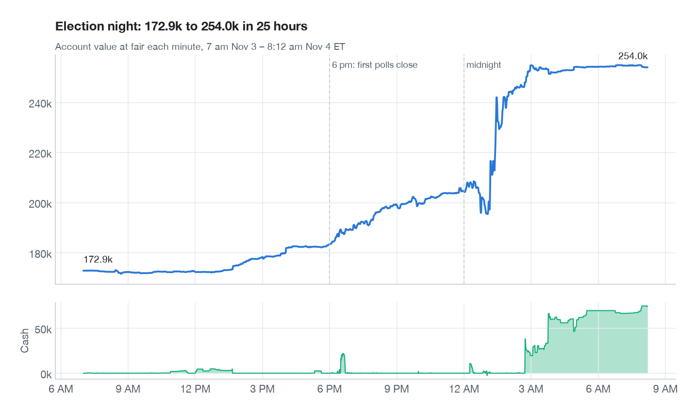
</picture>

**Getting ready.** On November 2 at 4:33 pm the bot switched to final-days mode: normal takes left a 100,000 war chest untouched, a cash raise sold positions at up to 12% of the cash freed to fill it, sizes doubled, and near-certain moved to 97%. A looser swap rule I tried with it churned 45,000 of positions at 12.4% cost for 5,200 of take edge in 15 minutes, so it was reverted. On November 3 at 2:29 pm a stale-gap rule stopped new risk wherever SIG had been 2+ points off fair for 10 minutes, unless the race had a live confirmed event. At 6 pm election-night mode turned itself on: a 30,000 cap per race for event trades, and the fastest polling for races whose polls had just closed.

**The night.** Account value at fair went from 172.9k at 7 am on Election Day to 254.0k at 8:12 the next morning, +81k. Most of it came between 1 and 3 am.

**8:13 am, parking.** By morning 74.8k sat idle. The 191 races Kalshi had already finalized had no live price, so the bot couldn't see them, yet 88 of them still sold the winner below 1 on SIG. A new task read Kalshi's results and bought the winner wherever SIG returned at least 1.5% to settlement, up to 10,000 per market. It added 3.5k.

**Noon, the bell.** The bot held 2,832 in cash and 39 positions. SIG's leaderboard valued them at its own last prices, 221,399, which put us 31st. At the actual results they were worth 253,916, and the rank has risen as markets settled.

## What 35 days of recordings show

The bot recorded Kalshi's and Polymarket's books and SIG's best prices for every market, every few seconds, for 35 days. With the results in, that's enough to look at the market itself, not just our account.

### Who forecast best

<picture>
  <source media="(prefers-color-scheme: dark)" srcset="figures/accuracy-dark.png">
  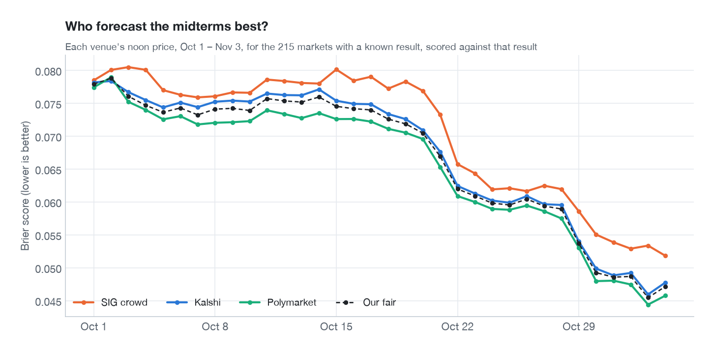
</picture>

For the roughly 215 markets with a known result, I scored each venue's price at noon every day with the Brier score (the mean squared distance between price and outcome, lower is better). **SIG's crowd was the least accurate on all 34 days.** On November 3, before the polls closed, it scored 0.0518 against 0.0478 for Kalshi and 0.0458 for Polymarket. Polymarket was slightly more accurate than Kalshi on 33 of the 34 days, and on average (0.0655 against 0.0675). Our blend sat between them: I weighted it toward Kalshi because Kalshi moved first, which helps a trader, but for accuracy Polymarket alone would have been a little better.

### SIG's longshot bias

<picture>
  <source media="(prefers-color-scheme: dark)" srcset="figures/longshot-dark.png">
  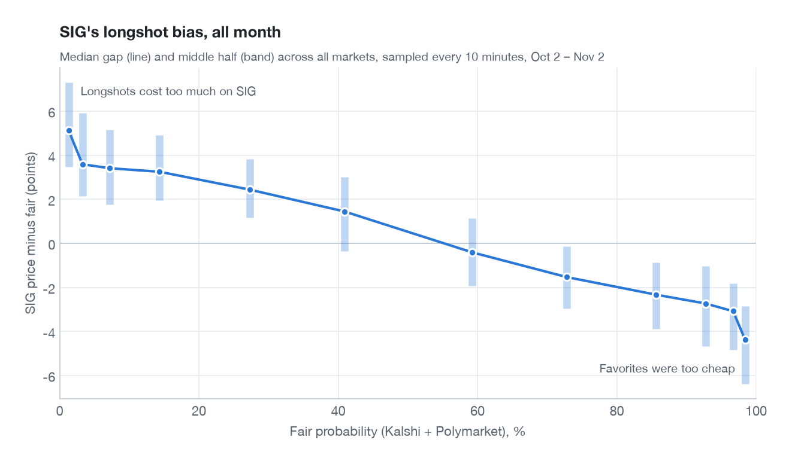
</picture>

SIG's prices were biased in one direction all month. Contracts that fair put under 2% traded a median 5.1 points above fair on SIG, and favorites above 98% traded 4.4 points below it. The results agree with fair: on November 1, SIG had 38 contracts under 10% whose results are now known, priced at 6.2% on average against 2.9% fair. None of them won.

This is where most of our steady October edge came from: selling longshots and buying favorites, then holding them to settlement. It's also why our cash was always tied up.

### SIG never caught up

<picture>
  <source media="(prefers-color-scheme: dark)" srcset="figures/efficiency-dark.png">
  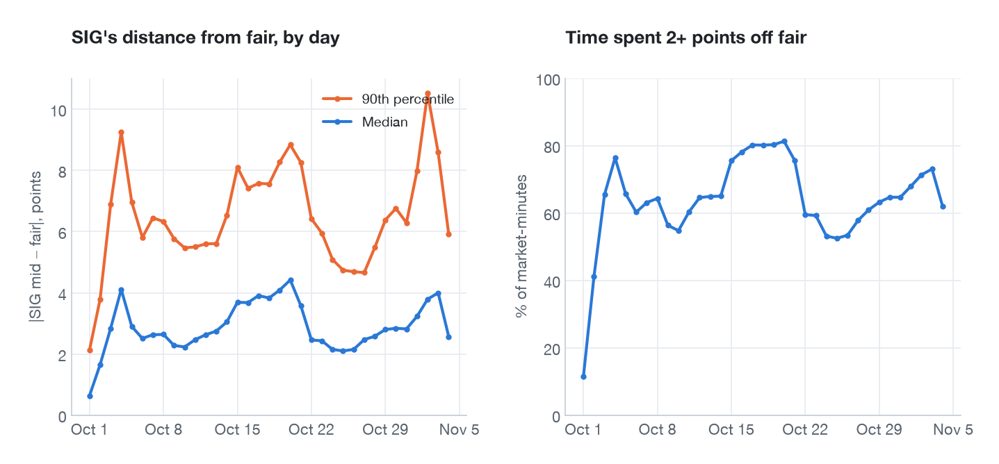
</picture>

You might expect a market full of bots to converge on the real-money price. It drifted away from it instead. On day one SIG's own market maker anchored most books near fair (a median gap of 0.6 points). After that the median gap was 2–4 points, and on a typical day about two-thirds of market-minutes sat 2+ points from fair. Closing those gaps meant tying up cash until settlement, and every bot ran into that wall.

### Election night: who moved first

<picture>
  <source media="(prefers-color-scheme: dark)" srcset="figures/night_lag-dark.png">
  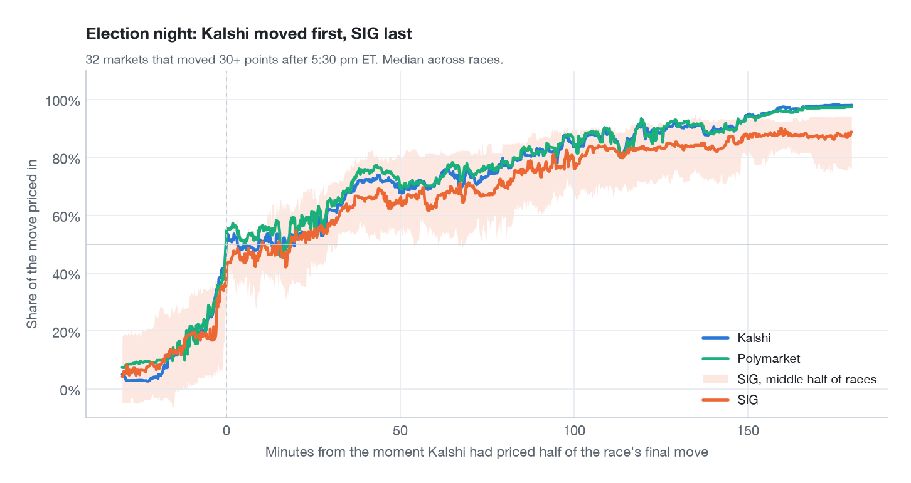
</picture>

32 markets moved 30+ points after 5:30 pm ET. I lined each one up on the moment Kalshi had priced half of its final move. Polymarket crossed the same line at the same moment (median 0.2 minutes earlier). SIG crossed it a median 1.4 minutes later, and a quarter of the races 7+ minutes later. Three hours on, the median race had 89% of its move priced in on SIG, against 98% on Kalshi. That lag, multiplied across dozens of races, is where the night's money was.

### Did our trades keep their edge?

<picture>
  <source media="(prefers-color-scheme: dark)" srcset="figures/markouts-dark.png">
  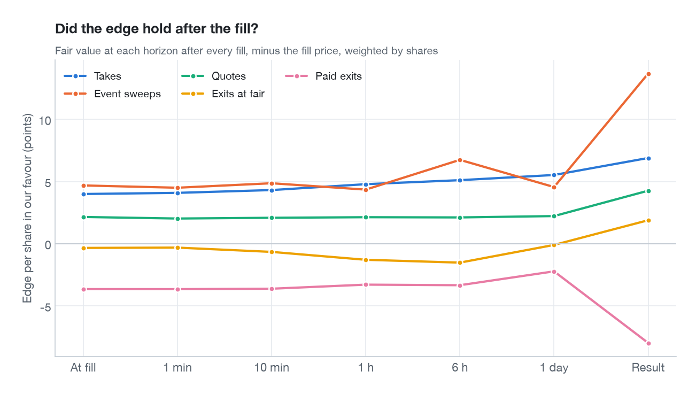
</picture>

For every fill I compared the price with fair 1 minute, 10 minutes, 1 hour, 6 hours and 1 day later, and with the result. There was no adverse selection. Takes started at 4.0 points of edge per share and grew to 5.5 a day later and 6.9 at the result, because the longshot bias kept working in our favour as Election Day approached. Quotes held 2.1 points throughout. Paid exits went the other way: −3.7 points when we sold, −8.0 at the result.

## How others made ten times more

<picture>
  <source media="(prefers-color-scheme: dark)" srcset="figures/leaderboard-dark.png">
  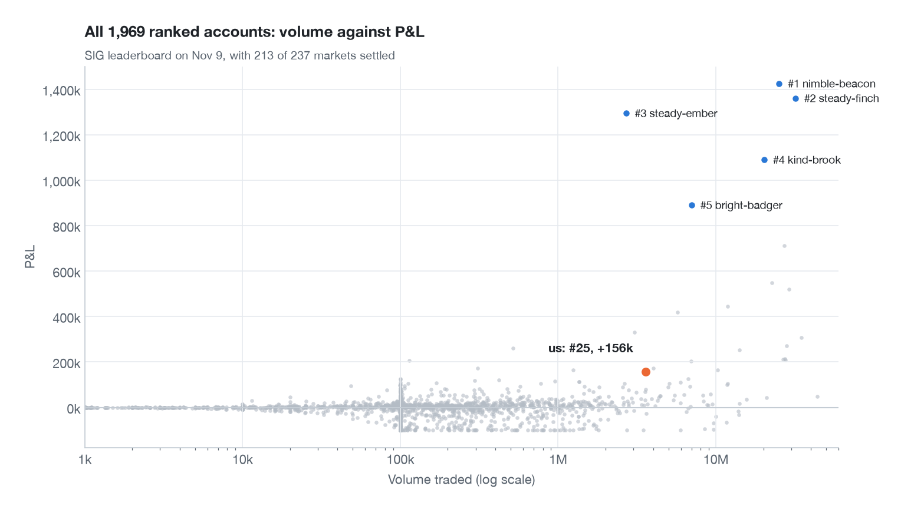
</picture>

The leader, nimble-beacon, is first on the board at +1.42 million with markets still settling, nine times our result. Their author has [written up the run](https://github.com/IHateVolatility/SIG-Prediction-Cup), and reading it next to our data explains most of the gap.

**1. They rested huge orders far from fair, from the first minute.** Their write-up describes 3,000-share orders at 0.5¢ and 99.5¢ in every market from the open, raised to 20,000 shares that evening and to 1 million on election night, waiting for anyone who sent an order without a price. Our day-one data shows how much that was worth: 64% of the off-fair value traded 25+ points from fair. 224 trades went through at 1¢ or less, or 99¢ or more, in markets where fair was at least 5 points from the limit: 1.29 million shares, 0.97 million off fair, in eight hours. Our quotes sat a few points around fair and never touched any of it.

**2. They read SIG's cash rule correctly, and I didn't.** On day one a 2,000-share test bid of ours was cut to 574, and I concluded that SIG reserves cash for every open order across the account. So the bot spread its cash thin and never rested big orders far away. The winner reports that SIG only counts your other orders in the same market, so one account can rest a huge order in every market at once. Looking back at our logs, we had under 3,000 of cash at the moment of that test, so it couldn't tell the two apart. I never ran the test that could have.

**3. They were faster at free money.** One fast account hit stale SIG prices with 1,000-share orders 0.2–2 seconds after Kalshi's first 1-point move, in market after market. Our event sweeps waited for 3 points and a confirmation.

**4. They turned capital over.** In the first week, accounts ranked 11–30 traded 0.5–0.8 million a day on about 100,000 of capital. We traded about 80,000 a day, because our inventory was longshot-bias positions held to settlement. Our P&L per unit of volume was higher (1.85% against 1.0–1.45%), but our volume was a sixth to a tenth of theirs.

**5. Some made big directional bets.** steady-ember finished third at +1.29 million on 2.7 million of volume, a 48% return on volume. That's a few large bets that came in, not market making.

**What I got wrong.** On day one I saw trades like 99,649 shares at 0.99 in a 1% race, and read them as bankroll transfers between friendly accounts. The simpler story fits better: people sent orders for a size without a price into empty books, and whoever had orders resting far from fair took the other side. That needs no one's cooperation, just the nerve to rest a very large order at a silly price.

## What I'd do differently

**Again:**

- Price everything from real-money venues and trade the distance. Their prices were better forecasts than SIG's every single day.
- Record everything from the first minute. SIG kept no book history, and the recordings answered every later question, including all of the analysis above.
- Log a reason for every cancel and refusal. It found the day-one idle bug in minutes.
- Measure the platform instead of trusting the docs: per-account limits and silent zero-size orders were both undocumented.

**Differently:**

- Spend an hour before the open testing what the exchange does with cash. The one assumption I didn't test cost the most.
- Rest very large orders far from fair from minute one. On day one, 3.6 million of value traded 25+ points from fair.
- Treat cash as the product. Holding longshot-bias inventory to settlement made steady money and starved everything else for a month.
- Trigger on Kalshi's first point, not its third. Most stale prices were gone within seconds.
- Don't pay to free cash unless the edge is big. Paid exits lost 92k against the results.
- Build parking before the last morning. Decided races sold their winners below 1 for hours.

## Data and code

The bot, its logs and the raw recordings stay private. [`prep_data.py`](prep_data.py) turns the recordings into compact arrays, and [`make_figures.py`](make_figures.py) draws every chart above in light and dark. Times are US Eastern. "Fair" always means our Kalshi/Polymarket blend, and a point is 1¢ of probability. P&L at the results uses SIG's settlement where it has settled and Kalshi's final result otherwise.

Thanks to SIG for running the Cup. I'll update the final rank once every market has settled.
